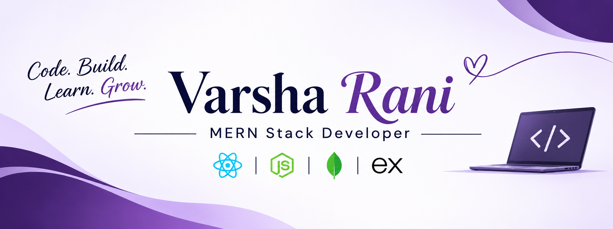

<!-- ================= PROFILE BANNER ================= -->

  

<h1 align="center">Hi there 👋, I'm Varsha Rani</h1>

<h3 align="center">
  B.Tech CSE Final Year Student | Full Stack Developer | MERN Stack Developer
</h3>

  

  
  

---

##  About Me

Hello! I'm **Varsha Rani**, a final-year Computer Science and Engineering student from ** India**.

I'm passionate about Full Stack Web Development and enjoy transforming ideas into functional, user-friendly web applications.

I specialize in the **MERN Stack (MongoDB, Express.js, React.js, Node.js)** and have hands-on experience building full-stack applications, designing REST APIs, managing databases, and implementing application functionality.

I believe in continuous learning, practical implementation, and improving my problem-solving abilities through coding.

-  Pursuing B.Tech in Computer Science and Engineering.
-  Passionate about Full Stack and MERN Stack Development.
-  Interested in building real-world web applications.
-  Continuously improving my backend and frontend development skills.
-  Practicing Data Structures and Algorithms.
-  Open to collaboration, internships, and software development opportunities.
-  Goal: To become a skilled Software Developer and contribute to impactful projects.

**My Motto:** Code. Build. Learn. Repeat.

---

## 💻 What I Do

### 🌐 Full Stack Web Development

- Develop dynamic and responsive web applications using React.js.
- Build backend applications using Node.js and Express.js.
- Design and integrate RESTful APIs.
- Implement authentication and authorization using JWT.
- Manage application data using MongoDB and Mongoose.
- Build user-friendly interfaces using Bootstrap and Tailwind CSS.

###  Frontend Development

- Create responsive and interactive user interfaces.
- Develop reusable React components.
- Work with React Hooks and component-based architecture.
- Focus on clean UI, usability, and responsive layouts.

###  Backend Development

- Develop REST APIs using Express.js and Node.js.
- Handle server-side application logic.
- Work with MongoDB and MySQL databases.
- Implement authentication and database operations.

###  Problem Solving & DSA

- Practice Data Structures and Algorithms using Java.
- Work on coding problems and logical challenges.
- Improve problem-solving and analytical thinking.
- Focus on time and space complexity.

---

##  Tech Stack & Tools

### Programming Languages

  
  
  
  
  

### Frontend Development

  
  
  
  
  

### Backend Development

  
  

### Database

  
  

### Tools & Development Environment

  
  
  
  

---

##  Featured Projects

Here are some of my projects that demonstrate my development skills and practical experience.

### 1.  PG Finder – PG Accommodation Platform

**Tech Stack:** MongoDB | Express.js | React.js | Node.js | Tailwind CSS

A full-stack accommodation discovery platform designed to help students find suitable PG accommodations based on their preferences and requirements.

**Key Features:**
- Search and explore PG accommodations.
- Support for boys, girls, and co-living options.
- Filter properties based on location, budget, facilities, and room preferences.
- Owner dashboard for managing properties and rooms.
- Admin verification system for property listings.
- Nearby tiffin and local service discovery.
- Booking and payment workflow.

### 2.  Tomato – Food Delivery Application

**Tech Stack:** MongoDB | Express.js | React.js | Node.js

A full-stack food delivery application that allows users to explore food items, manage their carts, and place food orders.

**Key Features:**
- Browse available food items.
- Add and remove products from the shopping cart.
- Place food orders.
- Admin panel for managing food items and orders.
- Order management functionality.
- Stripe payment integration.

---

## GitHub Statistics

  
  

##  GitHub Contribution Streak

  

##  Contribution Activity

  

---

##  Current Goals

- Build more real-world MERN Stack applications.
- Strengthen backend development and API design.
- Improve Java DSA and problem-solving skills.
- Write clean, reusable, and maintainable code.
- Improve software development and interview skills.
- Contribute to collaborative development projects.

---

##  Let's Connect

I'm always interested in connecting with developers, learning new technologies, and collaborating on interesting projects.

  
  
  

   India

---

##  Developer Quote

  <i>"Great things are built one line of code at a time."</i>

---

  <b>Thanks for visiting my GitHub profile! </b>
   
  If you find my projects interesting, consider giving them a .
    
  <b>Happy Coding! </b>

